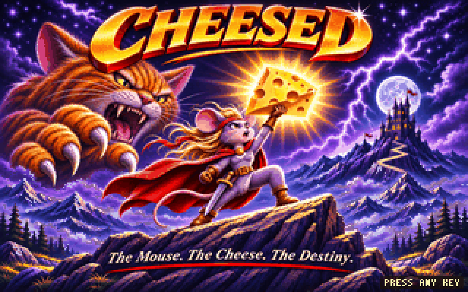
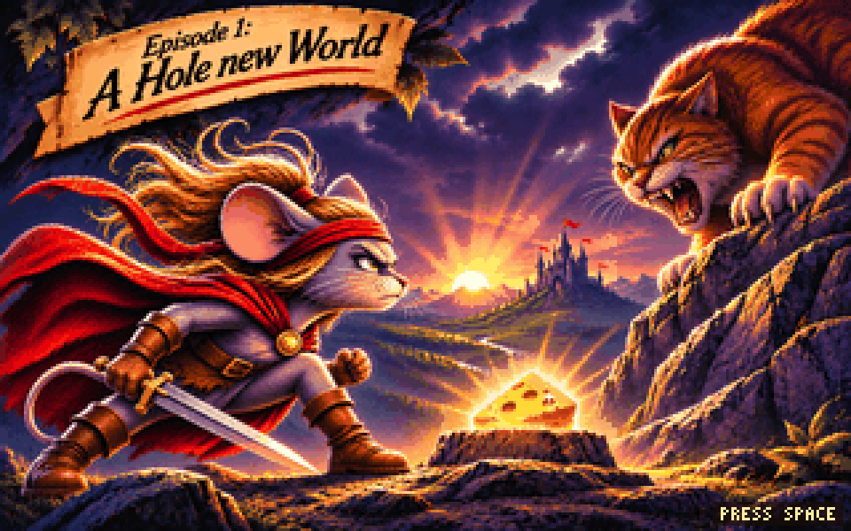
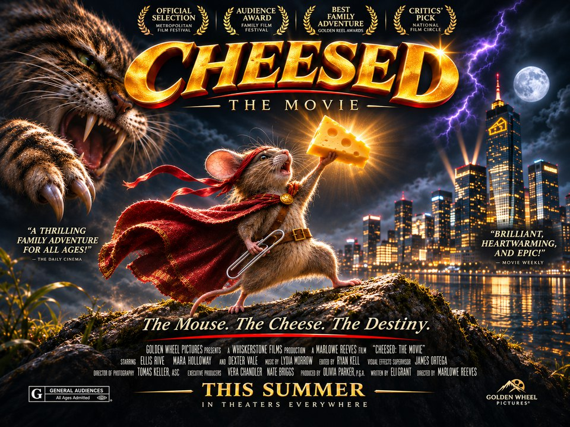

# Cheesed!

### *The Mouse. The Cheese. The Destiny.*

A thrilling action adventure in DOS-era dress, in which one mouse stands between the cats and
the cheese, and the cheese stands between the cats and their dinner. It's written in Rust on
[game-toolkit](https://github.com/sunsided/game-toolkit) and runs natively as well as in the
browser.



Storms gather over the mountains, the castle watches from its peak, and somewhere below a very
large cat is having a very bad day. What happens next is best experienced first-hand (and
with the sound on).

## Episodes

This is Episode One, *A Hole New World*, the shareware episode: please copy this disk for all
your friends.



## Building

You need a Rust toolchain; [go-task](https://taskfile.dev) is optional but saves typing, and
the browser build needs [trunk](https://trunkrs.dev) and the `wasm32-unknown-unknown` target
(`task setup` installs both):

```sh
task run                         # native (PROFILE=release for a release build)
task web                         # in the browser at http://localhost:8080
PROFILE=release task web:build   # browser build into dist/, ready to upload
task test
```

Plain `cargo run` works too. Your progress is saved in your data directory natively, and in
the browser's local storage on the web.

## On your own site

`task web:export DEST=../my-site/static/cheesed` copies a release build (`cheese.js`,
`cheese_bg.wasm` and the license notices) wherever you like; it uses relative paths, so it
works from any URL path. For SvelteKit, drop in [`embed/Cheesed.svelte`](embed/Cheesed.svelte):

```svelte
<Cheesed onexit={() => goto('/games')} oncomplete={(r) => console.log(r.stars, r.max)} />
```

Without Svelte, create a `<canvas id="cheese" tabindex="0">` yourself, then
`import('/cheesed/cheese.js').then((m) => m.default())`. The game talks to the page through
DOM events on that canvas (and `postMessage` when it runs in an iframe):

| Event | When | `detail` |
|---|---|---|
| `cheese:start` | the player starts a level | `{ level }` |
| `cheese:complete` | the player reaches the end of the episode | `{ stars, max }` |
| `cheese:exit` | the player leaves; the game goes quiet until a key press | |

Dispatching `cheese:restart` on the canvas starts over at the title, keeping saved progress.
While the canvas is detached from the page, the game pauses and goes silent.

## How it's made

It's the sister project of [Cookie D'oh!](https://github.com/sunsided/cookie-doh) and borrows
its approach rather than its looks:

- Everything is drawn into a 320×200 framebuffer on the CPU, which is uploaded as a single
  texture each frame and scaled up by whole pixels.
- Sprites are ASCII art in the source code, one character per palette entry.
- All sound is synthesized in code: the chiptune metal plays live on game-toolkit's synthie
  synth from songs written in tracker notation, and the sound effects (the thunder included)
  are rendered at startup. No sample files.
- The title cards are paintings reduced to 256 colours, like the title pictures of the time,
  and brought to life by moving the painting's own pixels: colour-cycled water, drifting mist,
  flickering windows, waving flags and lightning on cue.

## Coming soon

We're looking forward to the theatrical release.



## License

The source code is EUPL-1.2 (`LICENSE`). The notices for every bundled dependency are in
`THIRD_PARTY_LICENSES.html`.

The paintings embedded in the game (`src/render/*.bin`) and the images in `docs/screenshots/`
are not EUPL: they are © Markus Mayer under `LICENSE-ART`. Copy, modify and redistribute
Cheesed! with them, also commercially, as long as you credit them ("Artwork by Markus Mayer,
from Cheesed!"). Using them in another game or work, or passing them off as your own, needs
permission.
